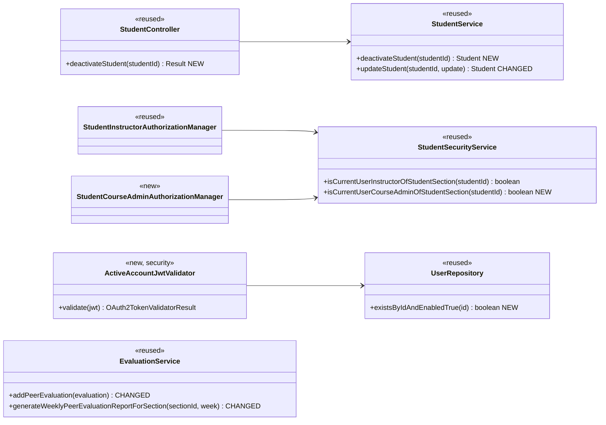
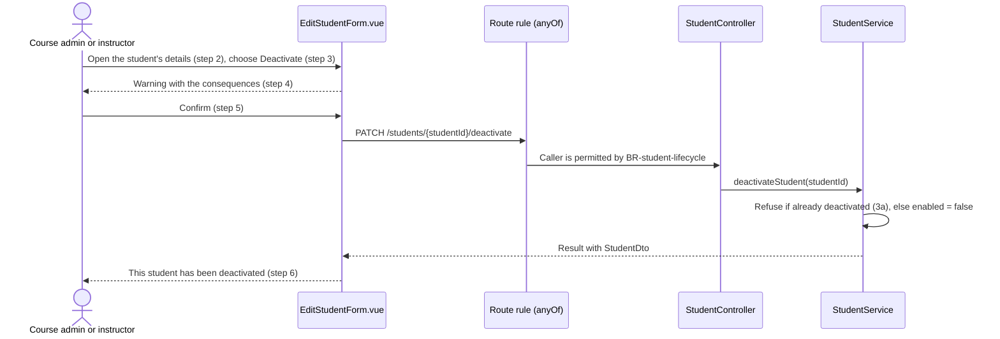
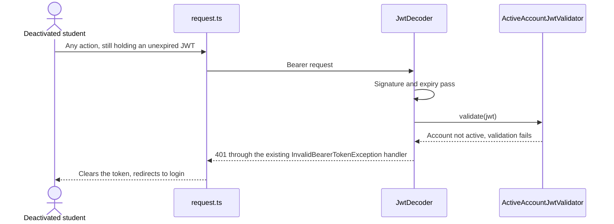
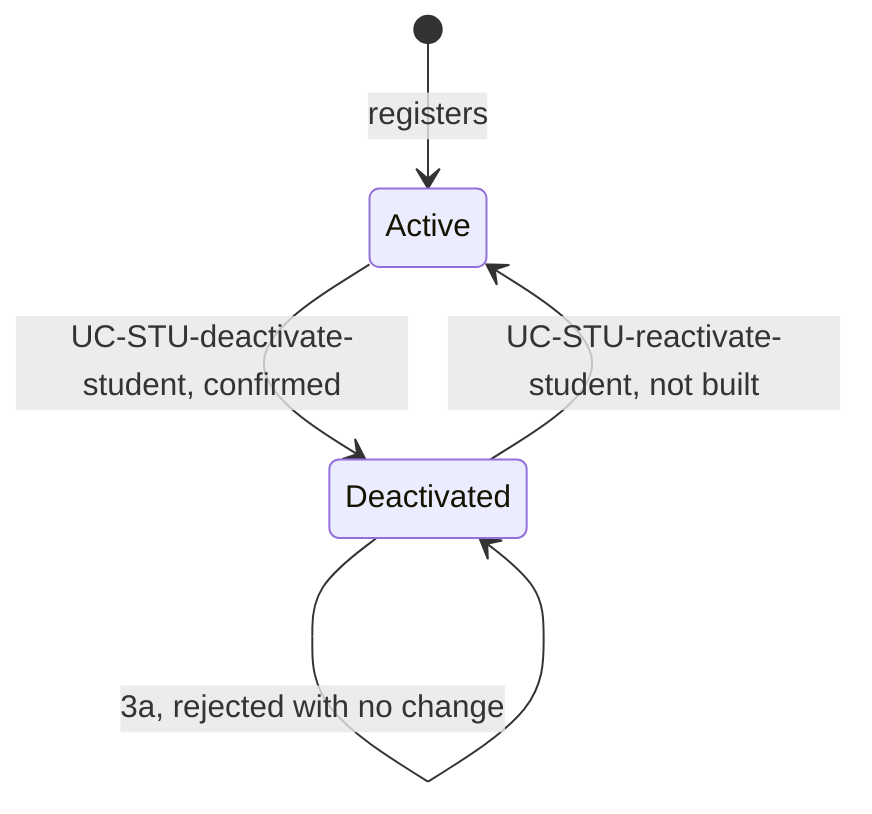

# Students (STU) Design

> Realizes: UC-STU-deactivate-student
> Depends on: FR-SEC-active-account, BR-student-lifecycle, BR-deactivated-student-team, BR-evaluation-deactivated-student, BR-submission-owed, BR-evaluation-editable-until-close, BR-section-scoped-access, BR-role-based-access, BR-lock-expiry
> See: [use cases](../requirements/use-cases.md#student), [business rules](../requirements/business-rules.md), [architectural-design.md](architectural-design.md#crosscutting-concepts) (Authentication, Authorization)
> Designed against `main` at `59f0267` (2026-11-06).

## Overview

This area covers a student's account in the foundation `student` slice of the REST API container. Before this design, deactivation was a Status switch on the student edit form, with no warning, and it took effect only at the student's next login. This design adds a dedicated, confirmed action, makes it the only way to deactivate, and ends a session already open by rejecting the student's token on her next request. No schema changes: `PeerEvaluationUser.enabled` already holds the state.

## Components & classes

**Backend** (under `backend/src/main/java/team/projectpulse/`):

- `student/StudentController.java`, `student/StudentService.java`, `student/StudentSecurityService.java`: as diagrammed. `updateStudent` stops writing `enabled`, which removes its only `SecurityContextHolder` read (part of OI-63).
- `security/SecurityConfiguration.java`: the new route rule, and `jwtDecoder` keeps Spring's default validators and adds `ActiveAccountJwtValidator`.
- `security/ActiveAccountJwtValidator.java` (new): reads the `userId` claim and passes only if `existsByIdAndEnabledTrue` is true. A missing claim fails. If the lookup itself throws, the exception propagates as a `500`: the request is still refused, and a database outage doesn't log everyone out.
- `security/authorizationmanagers/StudentCourseAdminAuthorizationManager.java` (new): the same thin shape as `StudentInstructorAuthorizationManager`.
- `user/UserRepository.java`, `evaluation/EvaluationService.java`: as diagrammed.

**Frontend** (under `frontend/src/`):

- `apis/student/index.ts`: new `deactivateStudent(id)`.
- `pages/students/EditStudentForm.vue`: Status becomes read-only. A Deactivate button, shown only for an active student, opens an `ElMessageBox.confirm` with the text "This student will no longer be able to log in or submit weekly activity reports and peer evaluations. Her account and submitted work are kept, and the account can be reactivated." On success it shows the step 6 message and emits `close-dialog`, which reloads the list and discards unsaved edits in the form. On a `400` (a stale dialog, extension 3a) the shared toast shows "This student is already deactivated." and the form reloads the student, so the button disappears (3a1).
- `pages/students/Students.vue`: status labels become Active and Deactivated.
- `pages/evaluations/SubmitTeamsEvaluations.vue`: the starting set of new evaluations omits a teammate whose `enabled` is false. An evaluator who already submitted this week sees her existing evaluations through `getEvaluationsByEvaluatorIdAndWeek`, as today, so a deactivated teammate appears only if that evaluator already evaluated her, and stays editable (BR-evaluation-editable-until-close). A `400` from `POST /evaluations` on a stale form uses the shared toast with the text "This teammate has been deactivated and can no longer be evaluated."

Reused without change: `SubmissionStatusService` already excludes a deactivated student from who owes what, so the "missing peer evaluations" list needs no code. `request.ts` already handles a `401`.

## Sequence

### UC-STU-deactivate-student: main success scenario

### UC-STU-deactivate-student: open session (FR-SEC-active-account)

### Student account lifecycle

## API contract

| Endpoint or job | Caller (who may) | Request | Success | Errors, by extension |
|---|---|---|---|---|
| `PATCH /students/{studentId}/deactivate` (new) | Course admin of the student's course, or instructor assigned to the student's course section | No body | `200`, `StudentDto` with `enabled` false | 3a: `400`, no change. 3b: `403`, no change. An id naming no student: `403`. No token, or a deactivated caller: `401` |
| `PUT /students/{studentId}` (changed) | Unchanged | Unchanged; `enabled` is ignored | Unchanged; `enabled` keeps its stored value | Unchanged |
| `POST /evaluations` (changed) | Unchanged | Unchanged | Unchanged | Evaluatee is deactivated: `400`, nothing saved |
| `GET /evaluations/sections/{sectionId}/week/{week}` (changed) | Unchanged | Unchanged | Omits a deactivated student with no received evaluations that week | Unchanged |
| Every bearer-token route (changed) | Active accounts only | Unchanged | Unchanged | Deactivated or deleted account: `401` |
| `POST /users/login` (no code change) | Anyone | HTTP Basic | Unchanged | Deactivated account: `401` |

Extension 4a makes no request.

## Key decisions

- **An open session ends at the token decoder.** An `OAuth2TokenValidator` on `jwtDecoder` checks the account on every bearer request, reuses the existing `401` and login redirect, and covers instructors, as FR-SEC-active-account requires. The cost is one primary-key lookup per request. *Rejected:* a check on each route (100+ rules, and easy to forget one); a blocklist (adds per-instance state to a stateless app); waiting for the token to expire (violates the FR).
- **Who may call:** `AuthorizationManagers.anyOf(studentInstructor, studentCourseAdmin)`, following the `/sections/{sectionId}/reminders` rule. *Rejected:* `userOwnershipAuthorizationManager`, which lets a student act on herself and omits a course admin not assigned to the course section.
- **No second scoped query.** This departs from the two-point convention in [Authorization](architectural-design.md#authorization). That convention exists because a route rule proves only the container named in the URL, not the object beside it. Here the URL names only the student and the manager resolves that student itself, so that gap doesn't exist. *Rejected:* scoping through `UserUtils.getUserSectionId`, the caller's default course section, which would refuse an instructor assigned to several course sections.
- **One way to deactivate.** `updateStudent` ignores `enabled`, and this also stops a stale edit form re-enabling a student. *Rejected:* keeping the switch, which bypasses step 4. The accepted cost is recorded in UC-STU-reactivate-student.
- **`PATCH .../deactivate` is its own route,** with `/glossary-terms/{glossaryTermId}/rename` as precedent, and the reactivate use case can mirror it. *Rejected:* a flag on `PUT`, which can't carry extension 3a or a separate authorization rule.
- **The action lives in the details dialog,** so step 2 happens before step 3. *Rejected:* a button on the table row, which skips step 2.
- **Extension 3a is a `400` through `IllegalArgumentException`,** like other domain refusals here. *Rejected:* a new `409` exception type, which adds a class and a handler for a rare case the SPA treats the same way.
- **Peer evaluation rules are enforced on the server as well as in the form** (BR-evaluation-deactivated-student). `addPeerEvaluation` refuses a deactivated evaluatee; `updatePeerEvaluation` stays open under BR-evaluation-editable-until-close. *Rejected:* the form alone, because a direct request could still create one.
- **"Has received evaluations" decides the report row,** because each row averages evaluations received. Her self-evaluation counts as received, since it is in that average. The filter applies only to a deactivated student; an active student with none still gets a row. *Rejected:* counting evaluations she wrote, which would produce an empty row.
- **No code for edit locks or password reset.** A lock she holds lapses under BR-lock-expiry, and a reset password still can't log in. *Rejected:* releasing locks on deactivation, which couples `student` to RAM to save 15 minutes at most.

## Data model

No change, and no migration. See the SRS's [Business Domain Model](../requirements/software-requirements-specification.md#business-domain-model). Her team assignment is left as it is (BR-deactivated-student-team).

## Reuse & cross-cutting

Reuses JWT authentication and the `Result` envelope with `ExceptionHandlerAdvice` (`AccountStatusException` and `InvalidBearerTokenException` already map to `401`), the `anyOf` route pattern, `SubmissionStatusService` (BR-submission-owed), and `request.ts` `401` handling. No email is sent: the use case doesn't call for one.

## Tests

| Use case, flow | Level (unit / integration) | Asserts |
|---|---|---|
| Main, instructor assigned to the course section | Integration | `200`; `enabled` is false; her team and evaluations are unchanged |
| Main, course admin not assigned to the course section | Integration | `200`, at the API only ([OI-65](../requirements/OPEN-ISSUES.md)) |
| Main, service | Unit | Sets `enabled` to false and saves |
| 3a, direct request | Integration | `400`; still deactivated |
| 3a, action not offered | Cypress | No Deactivate button for a deactivated student |
| 3b, instructor of another course section | Integration | `403`; still active |
| 3b, a student, including on herself | Integration | `403`; still active |
| 3b, id naming no student | Integration | `403` |
| 4a, cancel at the warning | Cypress | No request sent; still active |
| Steps 3 to 6, warning and confirm | Cypress | Warning shows the consequences; success message; status is Deactivated |
| Open session, deactivated student's existing token | Integration | `401` on a read and on a submission |
| Open session, deleted account's token | Integration | `401` |
| Login with the correct password | Integration | `401` |
| `PUT` with `enabled` false, as instructor | Unit + integration | `enabled` unchanged; `StudentServiceTest.testUpdateIgnoresEnabled` replaces `testInstructorUpdatesStudent`, which asserted the old behavior |
| New evaluation of a deactivated teammate | Unit | `400`; nothing saved |
| Edit an existing evaluation of her, window open | Unit | Succeeds |
| Form, evaluator with no evaluations this week | Cypress | Deactivated teammate not listed |
| Form, evaluator who already evaluated her this week | Cypress | Deactivated teammate listed and editable |
| Report, week with no received evaluations | Unit + integration | Not in the report; not listed as missing |
| Report, week with received evaluations | Unit + integration | Listed |
| Report, week with only her self-evaluation | Unit | Listed |
| Her work is retained | Integration | Her evaluations still count in teammates' averages |

**Test setup.** The open-session tests log in over HTTP Basic first to get a real signed token, deactivate the student, then call with that token, because a mocked JWT would bypass the decoder this design changes. Integration fixtures (a course admin not assigned to the course section, a deactivated student, weeks with and without received evaluations) are created inside each test on top of the `DataInitializer` seed, and the base class's `@Transactional` rollback removes them. Cypress stubs the state-changing requests with `cy.intercept`, so a run doesn't permanently deactivate a seed student.

## Open questions / risks

- **Accepted regression:** a mistaken deactivation can't be undone from the UI until UC-STU-reactivate-student ships.
- **Login message:** a deactivated student sees no message on the login page. `request.ts` shows no toast on a `401` and `Login.vue` only logs the error, so it looks the same as a wrong password. The use case doesn't require a message; left as a follow-up.
- **Course admin not assigned to the course section:** the route admits her, but the UI can't reach it, because the student read and the default course section rule both refuse her before step 2 ([OI-65](../requirements/OPEN-ISSUES.md)). The main-flow test for her is at the API only.
- **Stale peer evaluation form:** `submitPeerEvaluations` sends every evaluation at once and doesn't catch a refusal. The refused teammate's toast shows and the others save, but the Submit button keeps spinning until a reload. Left as a follow-up; the Cypress test tolerates the uncaught rejection.
